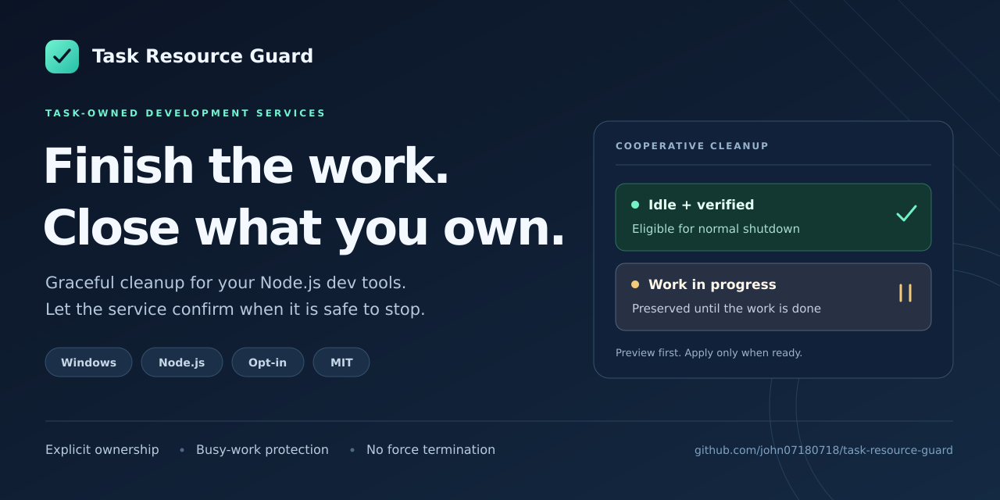

# Task Resource Guard

**Finish the work. Close the resources your task owns.**

A JavaScript resource helper, an opt-in Windows Node service adapter, and an AI Skill for development tools that need a clear end to their work. Preview eligible services, protect unfinished work, and request normal shutdown.

[](https://github.com/john07180718/task-resource-guard/actions/workflows/ci.yml)
[MIT license](LICENSE) · Early development · [繁體中文](README.zh-TW.md)



[Quick start](docs/QUICKSTART.md) · [Integrate a service](skills/task-resource-guard/references/usage.md) · [Install the Skill](INSTALL.md) · [Validation](VALIDATION.md)

## Try it with resources created just for the demo

For the documented Windows walkthrough, use **Node.js 24 and PowerShell 7**. Git is needed for the clone command; no npm install or API key is required.

```powershell
git clone https://github.com/john07180718/task-resource-guard.git
cd task-resource-guard
node examples/scoped-resource.mjs
```

The small example creates a private loopback listener, completes synthetic work, and awaits its normal close. Expected output:

```text
Private example resource closed normally.
```

To see registered cleanup protect busy work on Windows:

```powershell
node examples/registered-demo.mjs
```

The walkthrough creates two private HTTP services in a fresh temporary workspace. It previews both, closes the eligible idle service, finishes the busy service's request, then closes that service normally. It removes its own temporary workspace after confirming both children have exited. **This demo applies cleanup only to its own services; the general cleanup CLI still defaults to dry-run.**

See the [step-by-step guide](docs/QUICKSTART.md) for prerequisites, expected stages, and troubleshooting. Running an example does not install the Skill or connect your existing tools.

## Choose how to use it

| Your goal | Use this | What you provide |
| --- | --- | --- |
| Close a new resource after a task | `withOwnedResource` | Resource creation, awaited work, and a normal close callback |
| Clean up an idle development service | Service registration + cleanup CLI | Explicit ownership, tracked work, a synchronous safety check, and normal shutdown |
| Give an AI agent the same workflow | Optional Skill installation | A selected Skill location; each service still needs its own integration |

The helper attempts normal close even when work fails, and retains both errors if work and close fail. Registered cleanup checks service identity, expiration, idleness, and readiness again before shutdown, then checks whether the process exited.

## Preview first, integrate explicitly

Register only a task-private development service you own and can modify. The [adapter guide](skills/task-resource-guard/references/usage.md) explains how to track queues, downloads, writes, and logins; the tool cannot infer those states for you.

Once your service is integrated and its private registry is initialized:

```powershell
node skills/task-resource-guard/scripts/cli.mjs --workspace 'C:\Work\my-private-dev-tool'
```

This is a preview. Zero eligible services is a valid result. Add `--apply` only when you intend to request normal shutdown of eligible registered services. Expiration permits checks; it is never a forced-stop deadline.

## Scope and requirements

- **Registered cleanup:** Windows, local disk, Node.js, PowerShell 7, and the required CIM identity queries. Use the Node.js 24 setup in the quick start; [validation](VALIDATION.md) lists the environments actually checked.
- **Task-private resources:** development servers, test workers, and automation controllers that opt in. Production services, shared resources, and arbitrary existing processes are outside the supported scope.
- **Normal shutdown:** busy, uncertain, or failed-close cases are reported without force termination. Correct adapter integration is essential; shutdown may remain unconfirmed.
- **Private state:** keep the workspace's `.task-resource-guard` directory out of Git and uploads. It contains control capabilities and local identity information.
- **Honest limits:** no measured RAM, speed, cost, or token savings are claimed. Crashes or power loss can prevent cleanup. Platform evidence for the JavaScript helper is listed separately in [validation](VALIDATION.md).

The toolkit does not adopt arbitrary PIDs, clear browser data, install background polling, or repair Codex's own memory leaks. Scheduling and Skill installation are separate choices. Read the [security boundaries](SECURITY.md) before integrating a real service.

## Help improve the next version

This is an early development project. Check [Releases](https://github.com/john07180718/task-resource-guard/releases) for published versions and [validation](VALIDATION.md) for test evidence and untested conditions. The CI badge reports actual workflow status; a passing example does not validate every product integration.

If it helps your workflow, a **Star** makes the project easier to find again. Tried it? Open an [Issue](https://github.com/john07180718/task-resource-guard/issues) with your environment, the example or integration you tried, and what happened. Include sanitized output; keep private registry files and credentials out of reports.

[Contributing](CONTRIBUTING.md) · [Roadmap](docs/ROADMAP.md) · [Changelog](CHANGELOG.md) · [Release checklist](docs/RELEASE-CHECKLIST.md) · [Source and license provenance](PROVENANCE.md)

Independent project, with no claimed affiliation or endorsement by OpenAI, Codex, or another tool vendor.
